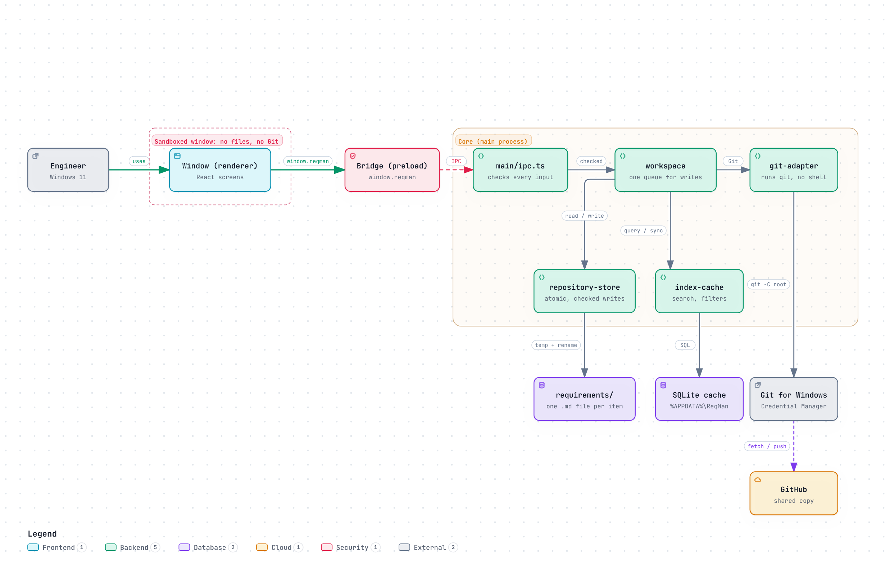
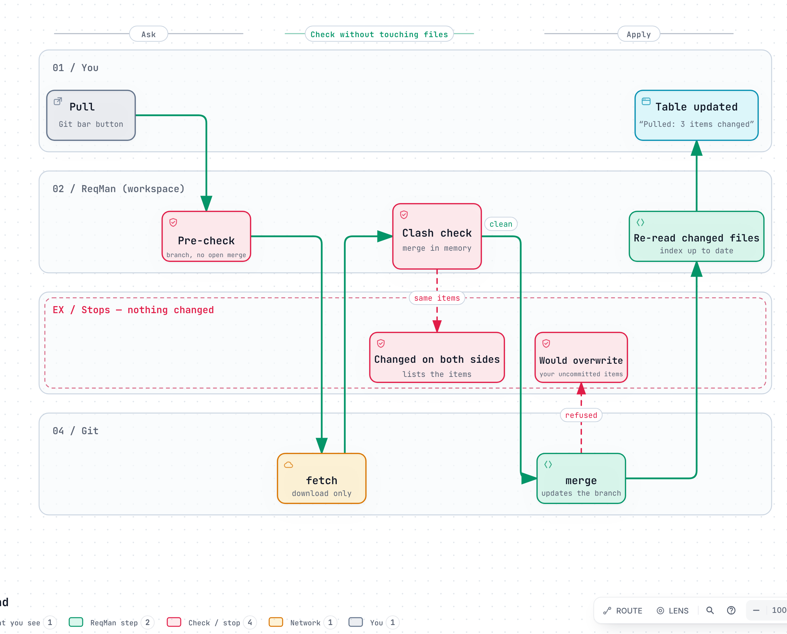

# Welcome to ReqMan — onboarding guide for engineers

Read this first (about 30 minutes). It explains what ReqMan is, how the parts fit together, how data moves through
them, and how to make your first change safely. Deeper references are linked at the end.

## 1. What ReqMan is, in one picture

ReqMan is a **small desktop app for managing requirements** (needs, system/software/hardware requirements, tests,
risks…) that replaces scattered Word and Excel files. It has **no server and no database of its own**:

- every requirement is a **plain text file** in a `requirements/` folder **inside the project's own Git repository**;
- **Git is the database and the version control**: history, sharing (pull/push), branches and reviews come from Git
  and GitHub;
- ReqMan is the window that understands those files: a tree table, an editor, typed links between items, "suspect"
  links, and Git actions shown per requirement instead of per file line.



The picture shows the whole system: the window, the bridge, the core with its modules, the files, the cache and
Git. Open [`docs/diagrams/architecture.html`](diagrams/architecture.html) in a browser for the interactive
version (zoom, dark mode, and each box links to the source lines it is drawn from).

## 2. Five ideas that explain most of the code

1. **Files are the truth.** One Markdown file per item (`requirements/items/<ID>.md`), YAML header + text. Anything
   else (the SQLite index, the UI state) can be thrown away and rebuilt from the files.
2. **Never lose or overwrite someone's work.** Every write checks that the file is still the version that was read
   (a *revision* hash); otherwise it refuses with a clear message. Writes are atomic (temp file + rename). Unknown
   header keys are kept. Git pushes are never forced; a pull that would clash stops before changing anything.
3. **Modules with one front door.** Each folder in `src/modules/<name>/` has an `index.ts` — the only file other code
   may import (ESLint enforces it). `src/main/composition.ts` is the one place where implementations are created
   and connected, so a module can be swapped in one line.
4. **The window cannot touch files or Git.** The UI (renderer) runs sandboxed; it only calls `window.reqman.*`,
   defined in `src/shared/api.ts`. All file, Git and database work happens in the main process, which checks
   every argument it receives (`src/main/validate.ts`). Every word on screen comes from `src/shared/text.ts`.
5. **One theme file.** Colours, fonts, sizes, radii and spacing come from `config/theme.json` as CSS variables
   (`--rm-*`). Hard-coded colours in the UI fail a test.

## 3. The parts and how they connect

The architecture picture in section 1 shows these parts and how calls travel between them.

| Part | Role in one sentence | Main files | Used by |
| --- | --- | --- | --- |
| **Renderer** (`src/renderer/src`) | Everything on screen: start screen, tree table, editor, links, Git bar, Changes, Compare, History, Fields, Export | `app/App.tsx`, `screens/WorkspaceScreen.tsx`, `workspace/*.tsx`, `styles.css` | the user |
| **Preload** (`src/preload/index.ts`) | The bridge: exposes `window.reqman`, turning each call into an IPC message | one file | renderer |
| **Contract** (`src/shared/api.ts`, `domain.ts`) | The types both sides agree on: every call, every data shape, every channel name | two files | everyone |
| **main/ipc.ts** | Receives calls, checks inputs, shows native dialogs (open folder, save file), forwards to modules | one file | preload |
| **main/composition.ts** | Builds all modules and wires them together — the only place to swap an implementation | one file | `main/index.ts` |
| **workspace** | "The open repository": opens/creates it and runs every user operation with the rules that need the whole set (no parent loops, conflict-safe saves, links, moves, schema fields, export). `workspace.ts` is the facade and runs every write and Git action through one queue (one at a time, like a mutex); the work is in small files: `itemOps`, `links`, `structure`, `schemaFields`, `exporting`, `gitOps` (commit/pull/push/history), `compare`, `watcher` (which files changed) | `workspace.ts` + the files named | ipc |
| **safe-files** | Writes files atomically and retries while Windows briefly locks a file | `index.ts` | store, workspace, ipc |
| **self-test** | The release self-test the owner runs in the app: the main actions on a practice repository | `index.ts` | composition |
| **repository-store** | Reads and writes the files in `requirements/` — atomic, revision-checked | `fileStore.ts` | workspace |
| **index-cache** | A local SQLite copy of all items for fast search, filters, counts, suspect links and problems; re-reads only changed files | `sqliteIndex.ts` | workspace |
| **git-adapter** | Runs the installed `git` (argument arrays, no shell, timeouts) and parses its output | `systemGit.ts` | workspace |
| **import-export** | Pure functions that turn items or a comparison into CSV (Excel) or Markdown; M7 adds Excel and import | `csv.ts`, `items.ts`, `compare.ts` | workspace |
| **items** | The domain core: item file format, IDs, validation, content fingerprint, field-level diff | `itemFile.ts`, `ids.ts`, `validate.ts`, `diff.ts` | store, index, workspace |
| **schema** | Reads `schema.yaml` (item types, fields, link types) and reports problems | `parse.ts` | store, items |
| **logger / theme / updater** | Log file with rotation · layered theme file · automatic updates from GitHub Releases | one implementation each | main |
| **sample-data** | Fictional requirement sets for tests and the in-app self-test | `generate.ts`, `benchmark.ts` | tests, ipc |

## 4. What the data looks like

An item file (`requirements/items/REQ-0033FVK.md`):

```markdown
---
id: REQ-0033FVK
type: system-requirement
title: Main PCB authenticates safety limits
status: Approved
priority: High
owner: L. Samir
tags:
  - i18n
  - release-1.0
parent: REQ-A6P9A8T
order: a0V
links:
  - type: refines
    target: REQ-ZWN5M8Q
    confirmed: 994b9d44bde8
---
The main PCB shall limit access tokens in all supported languages.
```

- `id` is `REQ-` + 7 random characters, so two people never need to coordinate numbers, and the type can change.
- `parent` + `order` build the hierarchy. `order` is an order key: there is always room between two keys, so a
  move rewrites only the moved file. The outline number shown in the window ("2.3.1") is calculated from these
  two, never stored. `links` are stored only on the source item ("this verifies that").
- `confirmed` is the fingerprint (type + title + text) of the target when the link was last confirmed; if the
  target changes, the link becomes **suspect** until someone confirms it.
- The project's `requirements/.reqman/schema.yaml` defines item types, fields (text, choice,
  list, number, date) and link types (name + reverse name). It is versioned with the requirements.

## 5. How a request travels — two examples

**Saving an item** (conflict-safe) — [interactive version](diagrams/save-flow.html):


**Pull** (stops safely before anything changes) — [interactive version](diagrams/pull-flow.html):



All diagrams in one place: open [`docs/diagrams/index.html`](diagrams/index.html) — a list on the left, the chosen
diagram on the right. The diagrams are made with [Archify](https://github.com/tt-a1i/archify) (Apache-2.0) from the JSON sources in
`docs/diagrams/archify/`; how to change and regenerate them is in `docs/diagrams/README.md`.

## 6. Your first day

1. Set up the PC: `docs/DEVELOPING.md` (Git, Node 22 — also without admin rights —, VS Code).
2. Clone this repository and the test data `Claude_SandBox` **next to** it, then `npm ci` and `npm run check`.
3. `npm run dev` starts ReqMan from the source. Open the sandbox clone: 10,005 fictional items with every kind of
   structure, link and deliberately broken file (see its README).
4. Click through the checklist in `docs/TESTING.md` once — it is the fastest tour of every feature.
5. Read `CLAUDE.md` (project memory: rules, decisions, pitfalls) and skim `docs/ARCHITECTURE.md`.

## 7. Making a change end to end (checklist)

Example: a new operation "mark several items as Approved".

1. **Domain/logic** in the right module (e.g. a pure helper in `items`, or the operation in `workspace`), using
   existing pieces: `repository-store.writeItem` with `expectedRevision`, then `index.syncPaths`.
2. **Contract:** add the call to `ReqManApi` and its channel name to `Channels` in `src/shared/api.ts`.
3. **Main:** add its handler to `handlers` in `src/main/ipc.ts`, checking inputs with `src/main/validate.ts`.
   The compiler reports a missing handler; the preload picks the new channel up by itself. If it writes, wrap it
   in the workspace queue (`q(...)`).
4. **UI:** call `window.reqman.<name>()` from a component; use only `--rm-*` CSS variables for styling and
   put every text in `src/shared/text.ts`.
5. **Tests:** a unit test in `tests/` (real temp folders and real Git, no mocks for files), and extend
   `e2e/journey.e2e.mjs` when the user can see the feature.
6. **Docs and release:** the owner's checklist in `docs/TESTING.md`, `CHANGELOG.md`, `docs/ARCHITECTURE.md`
   (module map/UI table), the status in `CLAUDE.md`; bump `version` in `package.json` and push — the Windows build
   and release run on GitHub Actions.

If you change the SQLite tables, bump `FORMAT_VERSION` in `src/modules/index-cache/sqliteIndex.ts` and add a test
that opens an old cache file.

## 8. What protects you

| Check | Command | Runs in CI |
| --- | --- | --- |
| Type checking (main and renderer separately) | `npm run typecheck` | yes |
| Lint incl. module boundaries and React hooks rules | `npm run lint` | yes |
| Unit tests (incl. real Git with a bare remote and two clones) | `npm test` | yes |
| All three | `npm run check` | yes |
| Performance with 10,000 items (50,000: `test:perf:all`, releases) | `npm run test:perf` | yes |
| End-to-end scenarios in the real app (Playwright): the user journey, review fixes | `npm run build && npm run test:e2e` | yes |
| No literal words in screen code (texts live in `src/shared/text.ts`) | part of `npm test` | yes |
| A generated 10,000-item repository opened in the real app | `npm run measure:ui -- <folder>` | yes |

## 9. Glossary

| Term | Meaning |
| --- | --- |
| Item | One requirement, test, risk, heading… = one file |
| Schema | The project's item types, fields and link types (`schema.yaml`) |
| Link / reverse name | A typed relation stored on the source ("TC-1 verifies SYS-1"); shown from the other side by its reverse name ("verified by") |
| Suspect link | A link whose target's type, title or text changed after the link was confirmed |
| Fingerprint | Short hash of an item's type, title and text, used for suspect links |
| Revision | Short hash of a file's content when it was read; writes are refused if it changed meanwhile |
| Index cache | The SQLite file in `%APPDATA%\ReqMan\cache` — fast search; rebuildable at any time |
| Upstream | The remote branch a local branch pulls from / pushes to (e.g. `origin/main`) |
| Reflog | Git's local record of where the branch pointed over time — used to find "what the last pull brought in" |
| Working folder | The files on disk, including changes not committed yet |

## 10. Where to read more

- `CLAUDE.md` — project memory and working agreement (status, decisions, pitfalls). Keep it current.
- `docs/design/DESIGN.md` — domain analysis of five RM tools, every product decision, requirements, roadmap.
- `docs/ARCHITECTURE.md` — module map, rules, data format, UI structure.
- `docs/TESTING.md` — the owner's manual checklists and the two-PC trial.
- `docs/reviews/` — project reviews with known risks and proposed improvements.
- `CHANGELOG.md` — what changed in each version and what testing found.
